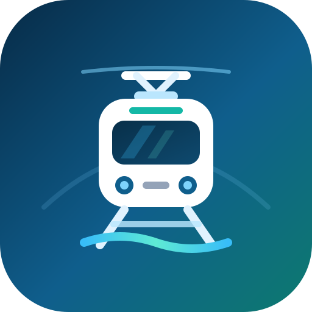

<p align="center">
  
</p>

# 🚋 Рельсоход — транспортно-пешеходный рандомайзер прогулок

**Рельсоход** превращает свободное время или привычную дорогу по городу в готовое мини-путешествие по **Санкт-Петербургу** и **Омску**. Выбирайте настроение, задавайте баланс между трамваем, метро/троллейбусом и пешими прогулками, планируйте поездку «к нужному часу» и выбирайте из 3 вариантов маршрута с готовой навигацией в Яндекс Картах.

> ### ⬇️ Быстро скачать приложение на Android
> **Android-приложение (Kotlin + Jetpack Compose)** — основная версия с плавной картой, автообновлением, фото-паспортом и удобным режимом «В пути».
>
> [](https://github.com/bebrik13773/Reslohid/releases/latest/download/Relsokhod-release.apk)
> &nbsp;
> [](https://github.com/bebrik13773/Reslohid/releases/latest)
>
> *Веб-версия подходит для быстрого знакомства без установки и для использования на ПК.*

---

## 🏙️ Поддерживаемые города

Сейчас в приложении доступны:

- **Санкт-Петербург** (6 линий метро `М1–М6`, вся действующая трамвайная сеть, линия «Славянка» этап 1 и проект № 22 до лета 2027)
- **Омск** (все 6 действующих трамвайных маршрутов, 7 магистральных троллейбусов `Тр-2, 3, 4, 7, 15, 16, 67` и встречные полукольца `2К`/`8К` до лета 2027)

Вашего города нет, но вы хотите, чтобы ваш город появился в «Рельсоходе»? [Отправить запрос на добавление города (`bober@craft-bober.ru`)](mailto:bober@craft-bober.ru?subject=%5B%D0%A0%D0%B5%D0%BB%D1%8C%D1%81%D0%BE%D1%85%D0%BE%D0%B4%5D%20%D0%97%D0%B0%D0%BF%D1%80%D0%BE%D1%81%20%D0%BD%D0%B0%20%D0%B4%D0%BE%D0%B1%D0%B0%D0%B2%D0%BB%D0%B5%D0%BD%D0%B8%D0%B5%20%D0%B3%D0%BE%D1%80%D0%BE%D0%B4%D0%B0&body=%D0%9D%D0%B0%D0%B7%D0%B2%D0%B0%D0%BD%D0%B8%D0%B5%20%D0%B3%D0%BE%D1%80%D0%BE%D0%B4%D0%B0%3A%20%0A%D0%9E%D1%81%D0%BE%D0%B1%D0%B5%D0%BD%D0%BD%D0%BE%D1%81%D1%82%D0%B8%20%D1%82%D1%80%D0%B0%D0%BC%D0%B2%D0%B0%D0%B9%D0%BD%D0%BE%D0%B9%20%D1%81%D0%B5%D1%82%D0%B8%20%2F%20%D1%81%D1%81%D1%8B%D0%BB%D0%BA%D0%B0%20%D0%BD%D0%B0%20%D1%81%D1%85%D0%B5%D0%BC%D1%83%3A%20%0A%D0%9A%D0%BE%D0%BD%D1%82%D0%B0%D0%BA%D1%82%20%D0%B4%D0%BB%D1%8F%20%D1%81%D0%B2%D1%8F%D0%B7%D0%B8%20%28%D0%BF%D0%BE%20%D0%B6%D0%B5%D0%BB%D0%B0%D0%BD%D0%B8%D1%8E%29%3A%20)

---

## ✨ Что умеет приложение

- **🔺 Треугольный баланс прогулки**
  Наглядный регулятор с тремя вершинами: **Трамваи**, **Транспорт** (метро, троллейбусы, автобусы) и **Пешком**. Передвигайте точку внутри треугольника или выберите быстрый пресет (*«Метро + пешком»*, *«Трамвай + прогулка»*, *«Макс. пешком»*) — алгоритм соберёт поездку нужного ритма.
- **🕒 Режим «Прибыть к часу» и 3 варианта маршрута**
  Укажите, к какому часу нужно оказаться на месте (например, к `18:00`), и приложение заполнит свободное окно интересной дорогой и пешей прогулкой с запасом до цели. Каждый подбор предлагает до **3 вариантов** — включая выход на соседней остановке с прогулкой пешком.
- **🗺️ Красивая сглаженная схема и Яндекс Карты в один тап**
  Линии на схеме плавно огибают повороты, выделяют станции метро и пунктиром показывают линии до лета 2027. Готовый маршрут одним нажатием открывается прямо в **Яндекс Картах**.
- **📅 Полная сеть двух городов и проекты до лета 2027**
  - **Санкт-Петербург**: все действующие трамвайные маршруты (включая сеть «Чижик», ретро-линию `Т1`, этап 1 «Славянки» № `2`), 6 линий метро `М1–М6` и строящийся 2-й этап «Славянки» (№ `22`, отметка «До лета 2027»).
  - **Омск**: все 6 действующих трамваев (№ `1, 2, 4, 7, 8, 9`), 7 магистральных троллейбусов (`Тр-2, 3, 4, 7, 15, 16, 67`) и встречные полукольца `2К` и `8К` до лета 2027.
- **🔁 Круговые маршруты, выбор цели и «Редкий борт»**
  Можно поехать к конкретному адресу/остановке, ткнуть точку прямо на карте, закрыть прогулку кругом (старт = финиш) или включить приоритет редких ретро-вагонов и «Чижиков».
- **🎧 Официальные аудиогиды по маршруту, режим «В пути» и Паспорт поездок**
  Подбор готовых городских аудиогидов с официальных порталов (**Visit Petersburg**, **izi.TRAVEL · Петербургский Горэлектротранс**, **Музей ГЭТ**, **ТИЦ Омской области**) в привязке к линиям и районам вашей прогулки, таймер пересадок, опциональная озвучка остановок (TTS), фото-чекины и личный Паспорт поездок.
- **📍 Полезные точки рядом**
  Архитектура, парки, кофейни, необычные места и ближайшие магазины **«Пятёрочка»** и **«Перекрёсток»** по ходу вашего маршрута.
- **🎨 Оформление Material You, иконка «Нева» и анимированный сплеш**
  Фирменная трамвайная иконка в цветах Невы (адаптивная векторная для Android и PWA для веба), плавный анимированный экран запуска при старте приложения, Светлая, Тёмная или тема «Трамвай» и выбор цветового акцента в **Настройках**.

---

## 🚀 Как пользоваться: 4 простых шага

1. **Выберите город при первом запуске** (Санкт-Петербург или Омск) и при желании разрешите геолокацию — «Рельсоход» сам найдёт ближайшую остановку старта и предупредит, если вы находитесь в другом городе.
2. **Настройте треугольник баланса** во вкладке **«Поиск»**: например, *«Трамвай + прогулка»* для неспешного выходного или *«Макс. пешком»* для вечернего променада.
3. **Нажмите «Подобрать случайный маршрут»** (или укажите свой финиш / «Круговая прогулка»).
4. **Откройте вкладку «Маршрут»**: изучите плавную схему, откройте подобранный **официальный аудиогид**, запустите навигацию в **Яндекс Картах** или нажмите **«В пути»**, чтобы вести счётчик пересадок и сохранять фото в Паспорт.

---

## 📱 Как скачать и установить приложение на Android (`.apk`)

> Приложение полностью нативное (**Kotlin + Jetpack Compose**), работает быстро и без браузерных оболочек.

1. Откройте раздел **Releases** в этом репозитории на GitHub (каждая успешная сборка автоматически публикуется туда как последний релиз).
2. В блоке **Assets** скачайте **`Relsokhod-release.apk`** (или `Relsokhod-debug.apk`).
3. Откройте файл на смартфоне (**Android 7.0 и выше**) и установите приложение. При первом запуске разрешите установку из этого источника в настройках телефона.
4. Если при переходе со старой сборки Android сообщает *«Обновление конфликтует с другим пакетом»* (из-за смены ключа подписи или варианта `debug`/`release`), сделайте резервную копию **`.relsohod`** в Настройках, один раз удалите старую версию, установите новый `Relsokhod-release.apk` и восстановите файл `.relsohod`. Для владельца репозитория: чтобы ключ подписи не сбрасывался даже после 7-дневной паузы в кэше GitHub Actions, можно задать секрет `ANDROID_KEYSTORE_BASE64` в настройках репозитория.

---

## ❓ Частые вопросы (FAQ)

- **Как работают пересадки между трамваями, пешком и другим транспортом?**
  Маршрутизатор строит цепочку по реальной сети с учётом расписания и треугольника баланса. При пересадке на одном узле или соседних остановках закладывается около 5 минут на переход и ожидание. При высокой доле «Пешком» линии соединяются длинными прогулками через набережные и парки. При сдвиге баланса к «Транспорту» активно подключаются линии метро (М1–М6 в СПб) и магистральные троллейбусы Омска, а для изолированных точек при включённом резервном транспорте добавляется стыковочный автобус.
- **Как устроены режим «Прибыть к часу» и выбор из 3 вариантов маршрута?**
  В режиме «Прибыть к часу» вы задаёте время начала и час, к которому нужно быть на месте (например, 18:00): алгоритм рассчитывает свободное окно и наполняет его разнообразными пересадками и пешей частью с запасом на прибытие. Каждый поиск выдаёт до 3 вариантов на выбор — включая сценарий с ранним выходом на соседней остановке и спокойной прогулкой пешком до цели.
- **Что означает фильтр «Линии и продления до лета 2027»?**
  В справочнике и планировщике отмечены проекты со сроком запуска до лета 2027 года: 2-й этап линии «Славянка» в СПб (трамвай № 22 до мкр. «Славянка») и встречные трамвайные полукольца 2К и 8К в Омске. Если вы хотите планировать поездку только по уже открытым сегодня линиям, снимите эту галочку в параметрах или переключите чип в Справочнике на «Действующие».
- **Почему город может не определиться автоматически по геолокации?**
  Автоопределение поддерживает два города: Санкт-Петербург (в радиусе 42 км от центра) и Омск (в радиусе 32 км от центра). Если вы находитесь за пределами этих зон или в другом городе, приложение покажет предупреждение и предложит переключиться вручную. Также геолокация может не сработать при запрете доступа к геопозиции в браузере/системе, отключённом GPS или активном VPN — город всегда можно выбрать вручную в Настройках или на шаге обучения.
- **Почему трамвай «А» или часть линий не попадают в маршрут ночью и в выходные?**
  Алгоритм проверяет реальное время суток и день недели. Например, петербургский трамвай «А» ходит только по будням с утра до вечера, а регулярные линии работают в основном до полуночи (с отдельными ночными переходами). Поздней ночью приложение сообщит о паузе в движении или при высокой доле «Пешком» предложит прогулочный маршрут.
- **Можно ли строить маршруты почти без пересадок, по кругу или пешком?**
  Да — передвиньте точку в треугольнике баланса к вершине «Пешком» или выберите быстрый пресет. Если включить режим «Круговая прогулка», алгоритм вернёт вас обратно к точке старта. А если задать конкретную остановку или адрес назначения, маршрут подстроится точно к выбранной цели.
- **Как подбираются аудиогиды по маршруту?**
  Вместо синтезированного текста «Рельсоход» автоматически подбирает готовые аудиогиды с официальных городских и музейных порталов (Visit Petersburg, izi.TRAVEL · Петербургский Горэлектротранс, Музей ГЭТ, КГИОП, ТИЦ Омской области), привязывая их к линиям и районам вашей прогулки.
- **Как перенести избранное, паспорт с фото и настройки между браузером и Android?**
  Откройте Настройки и нажмите «Экспорт .relsohod» — скачается единый файл вида export-ГГГГ-ММ-ДД.relsohod. Его можно восстановить как в браузере, так и в Android-приложении (через Настройки или на втором шаге первого запуска): перенесутся избранные маршруты, история поездок с фото, город, тема и цветовой акцент.
- **Откуда берутся схемы и сохраняются ли мои данные на устройстве?**
  Используются актуальные схемы и расписания региональных источников (данные перевозчиков СПб и Омска, Комитет по транспорту СПб, Яндекс Карты, 2ГИС). Все параметры поиска, избранное и паспорт поездок сохраняются локально на вашем устройстве автоматически — регистрация не требуется.

---

<details>
<summary>🛠️ Для разработчиков: сборка из исходников, тесты и структура проекта</summary>

### Стек
- **Android (`android/`)**: Kotlin 2.0, Jetpack Compose, Material 3, JUnit 4, Gradle 8.14 (AGP 8.9.1, targetSdk 36, minSdk 24).
- **Web (`src/`)**: React 19, TypeScript, Vite, Tailwind CSS, Node `node:test` (`tsx`).

### Локальные команды

```bash
# Веб-версия и синхронизация данных в Android assets
npm install
npm run dev           # Локальный сервер (http://localhost:3000)
npm test              # Юнит-тесты алгоритма маршрутизации (tsx --test)
npm run android:sync  # Экспорт актуальной сети в android/app/src/main/assets/tram_network.json
npm run build         # Production-сборка веба

# Нативный Android (требуются JDK 17 и Android SDK 36)
cd android
./gradlew testDebugUnitTest   # Kotlin JUnit-тесты (маршрутизатор и треугольный баланс)
./gradlew assembleDebug       # Сборка debug APK
```

### Основные модули
- `.github/workflows/build-android-apk.yml` — CI/CD автосборка `Relsokhod-release.apk` и `Relsokhod-debug.apk`.
- `src/utils/tramRouter.ts` & `android/app/src/main/java/ru/relsokhod/spb/router/TramRouter.kt` — многомодальный граф, Дейкстра и многокритериальный подбор с учётом `ModeBalance`.
- `src/utils/mapGeometry.ts` & `android/app/src/main/java/ru/relsokhod/spb/ui/components/TramMapCanvas.kt` — сглаживание линий кривыми Безье (Catmull-Rom) и разведение параллельных маршрутов по полосам.
- `src/components/ModeTriangleSlider.tsx` & `android/app/src/main/java/ru/relsokhod/spb/ui/components/ModeTriangleSlider.kt` — барицентрический треугольный регулятор баланса.

</details>
